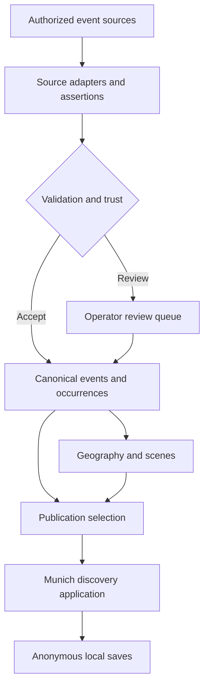
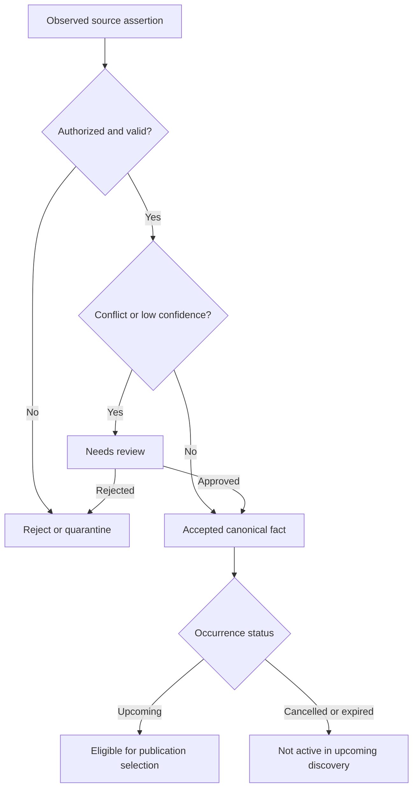
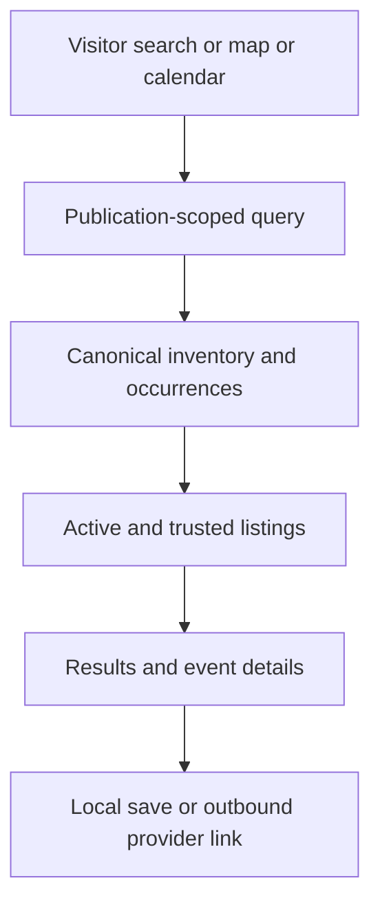

# Events Platform — Unified Plan

## Goal Capsule

- **Objective:** People exploring Munich can reliably discover and save real events and ongoing experiences, while operators maintain one trustworthy event inventory capable of powering independently branded city- and scene-focused publications.
- **Product authority:** This document records the approved Events Platform product decisions and M1/V1 boundaries. GitHub repository `danielslyman/events-platform` is the sole project repository. Prior implementation designs and unrelated projects are not authoritative.
- **Means:** A shared canonical event inventory with publication-specific selection and presentation.
- **Open blockers:** None preventing the gated M1 implementation. U0 must validate legal source access and proposed quantitative launch targets before dependent ingestion work proceeds; failed validation stops the affected work for product review.
- **Execution boundary:** Implement M1 only; full V1 and open ecosystem remain preserved as deferred product scope.

## Product Contract

### Summary

Events Platform combines consumer event discovery with a shared, scalable event intelligence and publishing foundation. Munich is the first launch market. Future independently branded apps and websites can select events by nested geography and overlapping scenes without copying canonical records. Consumer discovery comes first; open machine-readable interoperability is a longer-term direction.

### Problem Frame

City event information is fragmented across venues, organizers, feeds, and ticketing platforms. Visitors struggle to find relevant, current experiences, while separate specialist publications repeatedly collect and correct the same underlying information. Event discovery needs trustworthy shared facts without erasing local editorial identity.

### Actors

- **A1 Visitor:** Discovers and saves events without registration in M1.
- **A2 Platform operator:** Maintains sources, canonical records, trust and review policies, taxonomy, and publication governance.
- **A3 Publisher/editor:** Curates assigned publication content without altering canonical facts (full V1).
- **A4 Organizer:** Submits, claims, and corrects events with verification (full V1).
- **A5 Registered participant:** Synchronizes preferences and plans, coordinates, and books where supported (full V1).

### Key Decisions

All nineteen decisions were explicitly chosen by the user from alternatives during ce-brainstorm; the entries below index the governing requirements rather than restating them.

1. **Hybrid product vision** — consumer discovery first, open ecosystem later. Governs R1, R24. (session-settled: user-directed — chosen over discovery-only or open-protocol-first: consumer utility precedes ecosystem expansion)
2. **Universal city-explorer audience** — residents and visitors alike. Governs R1. (session-settled: user-directed — chosen over a single audience segment: discovery adapts to context)
3. **Events plus ongoing experiences** — not a generic place directory. Governs R2. (session-settled: user-directed — chosen over scheduled-only or all city places: include time-spanning experiences)
4. **Hybrid discovery** — deliberate exploration and recommendations. Governs R8, R18. (session-settled: user-directed — chosen over search-only or AI-first: both exploration modes matter)
5. **Hybrid sourcing** — aggregation and organizer contributions. Governs R3, R20. (session-settled: user-directed — chosen over a single source model: breadth plus direct corrections)
6. **Complete experience platform** — full V1 includes planning and supported transactions. Governs R21, R22. (session-settled: user-directed — chosen over discovery-only: participation is part of the product)
7. **One launch city** — focused validation. Governs R1. (session-settled: user-directed — chosen over broad launch: validate one market before expanding)
8. **Munich launch** — first market. Governs R1. (session-settled: user-directed — chosen over other cities: Munich is the initial proving ground)
9. **Progressive personalization** — useful before onboarding. Governs R18. (session-settled: user-directed — chosen over explicit-only or behavior-only: preferences improve gradually)
10. **Progressive identity** — anonymous first, account when needed. Governs R10, R19. (session-settled: user-directed — chosen over account-first or portable identity-first: avoid registration friction)
11. **Usable Munich discovery M1** — not merely an ingestion engine. Governs R1, R8. (session-settled: user-directed — chosen over data-only or full booking M1: prove real consumer value)
12. **Local-first saving** — device persistence without accounts. Governs R10. (session-settled: user-directed — chosen over mandatory accounts or share-link collections: immediate saving)
13. **Independent apps sharing canonical data** — publication independence. Governs R11, R12. (session-settled: user-directed — chosen over a single app with multiple views: distinct brands and products)
14. **Automatic discovery plus editorial curation** — independent presentation. Governs R13. (session-settled: user-directed — chosen over fully automatic or fully manual: combine scale and curation)
15. **Hierarchical overlapping scenes** — cross-city, multi-scene classification. Governs R14. (session-settled: user-directed — chosen over flat tags or full communities: expressive shared taxonomy)
16. **First-party and invited publishers** — scoped management. Governs R23. (session-settled: user-directed — chosen over first-party-only or open self-service: controlled partner participation)
17. **Verified authority with provenance** — governed factual corrections. Governs R5, R6. (session-settled: user-directed — chosen over source-only or organizer-only authority: trust and conflict resolution)
18. **Risk-based publication and review** — selective human oversight. Governs R7. (session-settled: user-directed — chosen over automatic-only or universal manual approval: scalable quality control)
19. **Adaptive freshness** — refresh by urgency and risk. Governs R4. (session-settled: user-directed — chosen over fixed-only or universal near-real-time polling: proportionate freshness)

### Requirements

**M1 — Munich inventory and trust**

- R1. Visitors can discover real Munich events through a public website without an account; the shared platform must remain capable of supporting additional cities.
- R2. Inventory includes scheduled events, recurring activities, and ongoing experiences, with distinct dated occurrences or valid ongoing schedules; generic place-only directory entries are excluded.
- R3. Multiple independent, authorized external sources contribute listings with retained source attribution and ingestion history, respecting applicable reuse and retention permissions.
- R4. Updates prioritize event proximity, source reliability, and change risk; expired and cancelled occurrences do not appear as active upcoming recommendations, while historical and cancellation information remains distinguishable.
- R5. Canonical records preserve provenance and distinguish verified information from unverified claims.
- R6. Material conflicts in dates, locations, cancellations, and other consequential facts are resolved by explicit authority rules or human review before being represented as verified.
- R7. Trusted validated submissions may be accepted into the canonical inventory automatically; suspicious, conflicting, or low-confidence submissions receive risk-based review before acceptance or verification. Appearance in a publication remains governed separately by R13.
- R8. Visitors can search and explore real listings through functional filters, categories, map, calendar, and event-detail views.
- R9. Event details communicate available schedule, time zone, location, description, pricing, and original booking or information links, explicitly distinguishing unknown or unverified fields from confirmed facts.
- R10. Visitors can save and remove events without registration; saved items persist across page reload and browser restart on the same device.
- R11. M1's Munich website selects from the shared canonical inventory rather than owning a duplicate event database.
- R12. The platform distinguishes canonical event facts from publication-specific selection and presentation, supporting multiple independently branded websites and apps in the long term.
- R13. Publication rules automatically select matching canonical inventory; M1 proves that selection without duplicating canonical facts. Full V1 adds authorized editorial featuring, exclusion, ordering, and enrichment that cannot alter canonical facts.
- R14. Geography supports nested locations, while hierarchical, overlapping scenes can span cities and events can belong to multiple scenes.
- R15. A source failure does not take down discovery or automatically discard previously valid canonical records.
- R16. Core discovery flows are usable on mobile and accessible by keyboard.

**Full V1 — experiences and publishing**

- R17. Users can plan experiences with collections, itineraries, reminders, and calendar interoperability.
- R18. Discovery improves through optional, transparent, editable preferences and meaningful interactions while remaining useful before personalization.
- R19. Accounts are introduced when needed for synchronization, collaboration, or transactions, preserving prior anonymous progress.
- R20. Organizers can submit, claim, and correct their listings subject to verification and permissions.
- R21. Users can coordinate attendance and plans with others, including invitations and shared decisions.
- R22. Where providers support it, users can reserve, buy tickets, and manage bookings through integrated flows.
- R23. Platform operators can invite publishers with permissions limited to assigned publications; editorial edits do not override canonical event facts.

**Long-term direction**

- R24. The platform should be able to participate in an open machine-readable event ecosystem; implementing federation or a new protocol is not required for M1 or full consumer V1.

### Key Flows

- **F1 — Source to inventory:** A2 authorizes a source; listings are ingested, normalized, attributed, matched to canonical events and occurrences, validated, and either accepted or reviewed. Covers R2–R7.
- **F2 — Munich discovery:** A1 opens the public site, explores by search/map/calendar/filter, and views details and external booking links. Covers R1, R2, R8, R9, R16.
- **F3 — Anonymous saving:** A1 saves an event, returns after restarting the browser, sees it retained, and can remove it. Covers R10.
- **F4 — Update and correction:** A source changes an event or reports a cancellation; the platform evaluates authority, updates the canonical record when justified, and affected publications reflect the corrected facts. Covers R4–R7, R11–R13.
- **F5 — Independent publication:** A2 configures a publication's geographic and scene selection; qualifying shared events appear without duplication. Full V1 editors may curate their own publication. Covers R11–R14, R23.

### Acceptance Examples and Measurement

The following are **proposed M1 acceptance targets**, not empirically validated commitments. Planning must assess data-source feasibility and confirm achievable thresholds before treating them as launch gates.

- **AE1 — Real coverage (R1–R3):** Given authorized live Munich sources, when ingestion completes, then listings from at least **3 independent sources** and at least **5 distinct event/experience categories** are discoverable.
- **AE2 — Schedule/location completeness (R2, R9):** Given a representative sample of published upcoming occurrences, at least **95%** have a usable location and an unambiguous time-zone-aware schedule or explicitly documented ongoing schedule; unknown values are not silently imputed.
- **AE3 — Deduplication (R3, R11):** Given a representative, independently labeled sample containing known cross-source duplicates and distinct events, target at least **95%** correct identity decisions, measuring false merges and missed merges separately. Sampling method, denominators, and acceptable error balance are deferred to planning.
- **AE4 — Cancellation propagation (R4, R6, R11):** Given a verified cancellation successfully ingested, affected publications no longer present the occurrence as active within **30 minutes**, including search, map, calendar, and recommendation surfaces where present; this measures post-ingestion propagation, not source detection latency.
- **AE5 — Local saving (R10):** Given an anonymous visitor saving an event, after reload and browser restart on the same device the saved item remains and can be removed, assuming local data has not been cleared.
- **AE6 — Source isolation (R15):** Given one unavailable source, discovery continues using previously valid records and other available sources, with freshness appropriately indicated.
- **AE7 — Shared record (R11–R14):** Given an event matching two publication selections across geography and scenes, both can reference the same canonical event and occurrence identities without copying factual records; M1 may validate this through two configurations without launching a second website.
- **AE8 — Trust (R5–R7):** Given conflicting start times from two sources, the platform retains provenance and does not silently present the lower-confidence claim as verified.
- **AE9 — Accessibility (R16):** A keyboard-only visitor can navigate search results, filters, event details, and saving; mobile layouts do not block these core tasks.

### Scope Boundaries

- **M1 includes:** Munich consumer discovery, multi-source real data, canonical normalization, deduplication, provenance, risk-based review, adaptive freshness, publication selection boundary, scene/geography classification, and anonymous local saving.
- **M1 defers:** account synchronization, recommendation personalization beyond useful anonymous discovery, organizer portals, invited publisher administration, advanced editorial tooling, collaborative planning, and integrated transactions.
- **Full V1 includes:** progressive identity and personalization, organizer participation, publisher permissions and curation, social planning, calendar interoperability, and provider-supported booking/ticketing.
- **Beyond V1:** open federation/protocol ecosystem and open self-service publisher marketplace are not current delivery requirements.
- **Non-goal:** generic restaurants, shops, landmarks, and other place-only listings unrelated to an event or ongoing experience.

### Assumptions and Risks

- Access to lawful, usable Munich event data from multiple independent sources is **not yet validated**; source licensing, attribution, permitted caching, and update limits require research.
- No numerical inventory volume, duplicate rate, or update SLA is yet proven feasible. The acceptance figures above are targets for feasibility testing, not guarantees.
- Source availability may constrain pricing, availability, cancellations, and ticketing information.
- Recurring and multi-day experiences require correct occurrence identity, local time zones, and cancellation/rescheduling behavior to avoid misleading users.
- Duplicate detection must avoid both repeated listings and accidental merging of distinct events; a single accuracy percentage alone can conceal either failure.
- Publication-level editorial overrides must never silently alter shared factual claims.
- A single logical canonical inventory does not prescribe one physical database instance forever; scaling and isolation mechanisms belong to implementation planning.
- Geographic hierarchy and scene taxonomy are independent facets, not a single rigid tree.

### Outstanding Questions

**Deferred to Planning**
- Which lawful sources and integration methods can satisfy AE1, and what attribution/retention obligations apply?
- What independent reference set, sampling protocol, false-merge/missed-merge measures, and monitoring process make AE2–AE4 measurable?
- What achievable refresh and propagation service levels do providers permit?
- Which two publication configurations and scene/geography test cases will prove R11–R14 in M1 without requiring a second deployed website?
- Which accessibility and operational checks demonstrate R15–R16?
- What delivery sequence minimizes risk while maintaining a working consumer milestone?

**Resolve Before Planning**
- None. If source feasibility invalidates AE1–AE4, return to product scope for explicit target adjustment rather than silently weakening requirements.

---

## Planning Contract

### Key Technical Decisions

- KTD1. **Modular monolith for M1.** Keep ingestion, canonical domain, publication selection, and consumer discovery in separately testable modules in one deployable system. The shared canonical inventory is logical, not a mandate for a permanently single physical database. Governs R1, R11–R14.
- KTD2. **Relational canonical core with spatial support.** Prefer PostgreSQL with PostGIS for event identity, occurrence schedules, venues, geography, source assertions, and publication membership; use relational links for overlapping scene classifications. Evaluate search indexing only after query and scale measurements. Governs R2, R3, R11, R14.
- KTD3. **Adapters and raw provenance.** Source adapters retain permitted source identifiers, observed timestamps, licenses, and source assertions. Canonicalization and confidence decisions are separate from collection. Governs R3, R5–R7.
- KTD4. **Identity and occurrence matching are distinct.** Deduplicate equivalent event identities and corresponding dated occurrences without merging genuinely separate performances or recurring instances. Track false merges and missed merges independently. Governs R2, R3.
- KTD5. **Risk-based state transition.** Model candidate, accepted, needs-review, rejected, superseded, and cancelled/expired occurrence states distinctly; public visibility requires accepted canonical facts plus publication eligibility. Governs R4–R7, R13.
- KTD6. **Adaptive scheduled refresh with urgent correction path.** Source policy determines polling cadence, rate limits, retry/backoff, and critical-update propagation. An internal propagation target does not promise external source detection speed. Governs R4, R15.
- KTD7. **Publication configuration as a domain boundary.** A publication owns filters and editorial overlays, not duplicated event facts. M1 proves two distinct configurations against one inventory, but deploys only Munich consumer discovery. Governs R11–R14.
- KTD8. **Anonymous local saving.** Store stable canonical references locally and resolve current event status on display; do not introduce an account service in M1. Governs R10.
- KTD9. **Evidence-gated source selection.** U0 must document source terms, attribution, retention, permitted display, API limits, freshness, and Munich coverage before production adapters are committed. A documented API is not proof of republishing permission. Governs R3–R5.
- KTD10. **Accessible progressive enhancement.** Search and event detail pages remain usable without advanced map interaction; map/calendar views enhance discovery. Governs R8, R16.

### High-Level Technical Design



**Lifecycle and authority**



**Request and delivery path**



### Output Structure

Proposed greenfield layout; exact framework and package conventions should be selected in U1 after examining available provider SDKs and deployment constraints.

```text
apps/
  web/                     # Munich discovery application
packages/
  domain/                  # events, occurrences, venues, scenes, geography
  ingestion/               # source adapters, provenance, reconciliation
  publications/            # selection and editorial boundary
  discovery/               # query and presentation contracts
  testing/                 # shared fixtures and contract tests
docs/
  plans/                   # this unified plan
  research/                # source feasibility evidence
```

### Sequencing and Stop Conditions

U0 is a hard feasibility gate. If three independent authorized sources or proposed quality targets cannot be supported, record evidence and seek product approval to adjust AE1–AE4; do not fabricate sources or silently lower thresholds. U1–U3 can be prepared using fixtures while external access is pending, but production ingestion and release validation depend on U0. Later units depend on canonical identity and publication boundaries.

### Planning Assumptions

- The repository is greenfield; no existing application framework or CI command is presumed.
- TypeScript-based web development and PostgreSQL/PostGIS are provisional engineering choices, not prior product decisions. U1 records the exact versions and deployment conventions.
- No live source credentials, redistribution rights, or partner booking access have been verified in this plan.
- Initial review workflows may be operator-only, without a full V1 organizer or publisher portal.
- A source can have multiple feeds but counts only once toward the independent-source target.

---

## Implementation Units

### U0. Validate Munich event sources and acceptance feasibility

- **Goal:** Produce an evidence-backed go/no-go decision for legal, useful, current Munich inventory before production ingestion.
- **Requirements:** R2–R7, R9; AE1–AE4.
- **Dependencies:** None.
- **Files:** `docs/research/munich-source-feasibility.md`, `docs/research/source-rights-matrix.md`, `packages/testing/tests/source-feasibility.spec.ts`.
- **Approach:** Evaluate official Munich data, ticketing/event providers, venue feeds, and other candidate sources individually. Record source ownership, independence, API/feed access, terms, attribution, retention, refresh limits, permitted display, coverage sample, and revocation procedure. Separate publicly accessible data from licensed republication. Document feasibility of proposed 3-source, 5-category, 95% quality, and 30-minute post-ingestion targets. Research candidates include Ticketmaster Discovery API/Feed, Munich Open Data, and Eventsimple; none is preapproved or assumed to satisfy licensing and coverage.
- **Test scenarios:**
  - Given three feeds from one owner, source counting treats them as one independent source.
  - Given a source allowing access but forbidding republication, it is excluded from the public-display inventory.
  - Given a candidate lacking cancellation updates, the report records the detection limitation rather than claiming the 30-minute target.
  - Covers AE1–AE4. Given sampled permitted sources, the feasibility report shows actual counts and target gaps with reproducible evidence.
- **Verification:** Rights matrix and dated coverage evidence exist; approved sources and any unmet thresholds are explicit; product escalation is recorded if needed.

### U1. Establish application and verification foundation

- **Goal:** Create a reproducible, tested greenfield modular monolith and local development environment.
- **Requirements:** R1, R11, R15, R16.
- **Dependencies:** None; must not bypass U0 for production sources.
- **Files:** `package.json`, `pnpm-workspace.yaml`, `apps/web/package.json`, `apps/web/tests/smoke.spec.ts`, `packages/testing/tests/workspace.spec.ts`, `.github/workflows/ci.yml`, `README.md`.
- **Approach:** Select and pin the application/runtime versions, establish module boundaries and fixtures, provision a local relational database with spatial support, and configure CI for type, lint, unit, integration, browser, and accessibility tests. Document actual commands in Verification Contract once established.
- **Test scenarios:**
  - Clean checkout installs and starts with documented prerequisites.
  - Invalid domain fixture fails a deterministic test and blocks CI.
  - Missing local database yields a clear startup failure rather than silently using production.
- **Verification:** CI runs from a clean checkout, fixtures are reproducible, and no real provider secrets are committed.

### U2. Build canonical event and taxonomy domain

- **Goal:** Represent canonical events, separate occurrences, venues, geography, and overlapping hierarchical scenes without duplication.
- **Requirements:** R2, R3, R11, R12, R14; AE2, AE7.
- **Dependencies:** U1.
- **Files:** `packages/domain/src/index.ts`, `packages/domain/src/events.ts`, `packages/domain/src/taxonomy.ts`, `packages/domain/tests/events.spec.ts`, `packages/domain/tests/taxonomy.spec.ts`, `packages/domain/tests/occurrences.integration.spec.ts`.
- **Approach:** Define stable event and occurrence identities, local time zone semantics, source assertion references, venue/geographic relations, and multiple scene membership. Preserve distinct performances and cancellation state. Add migration and fixture strategy within the selected database layer.
- **Test scenarios:**
  - Covers AE2. A recurring event with two dates produces one event and two independently addressable occurrences.
  - An event tagged Industrial Techno matches both the specific scene and its Techno ancestor without duplicate facts.
  - Two different performances at one venue and date remain distinct when evidence differs.
  - A DST boundary retains the correct Munich local time and offset.
- **Verification:** Domain tests and persistence round-trips prove identity, taxonomy, and scheduling invariants.

### U3. Implement source ingestion, reconciliation, and trust review

- **Goal:** Turn authorized source assertions into reliable canonical records using explicit trust decisions.
- **Requirements:** R3, R5–R7; AE1, AE3, AE8.
- **Dependencies:** U0, U2.
- **Files:** `packages/ingestion/src/adapters/index.ts`, `packages/ingestion/src/reconcile.ts`, `packages/ingestion/src/review.ts`, `packages/ingestion/tests/reconcile.spec.ts`, `packages/ingestion/tests/adapters.contract.spec.ts`, `packages/ingestion/tests/review.integration.spec.ts`.
- **Approach:** Implement only U0-approved adapters. Separate collection, validation, candidate matching, canonical resolution, and review. Retain permitted source evidence, audit consequential changes, and make ingestion idempotent.
- **Test scenarios:**
  - Covers AE3. Two permitted feeds describing the same occurrence resolve to one canonical occurrence with two source assertions.
  - Two similar but distinct club nights do not merge.
  - Covers AE8. Conflicting start times remain attributed and unverified until authority resolution.
  - Repeated imports do not create duplicate records.
  - A revoked or invalid source is blocked from new publication.
- **Verification:** Contract fixtures and independently labeled samples report false-merge and missed-merge rates separately.

### U4. Implement adaptive freshness and cancellation propagation

- **Goal:** Keep upcoming discovery accurate despite changing sources and transient failures.
- **Requirements:** R4, R6, R15; AE4, AE6.
- **Dependencies:** U3.
- **Files:** `packages/ingestion/src/scheduler.ts`, `packages/ingestion/src/updates.ts`, `packages/ingestion/tests/freshness.spec.ts`, `packages/ingestion/tests/cancellation.integration.spec.ts`.
- **Approach:** Apply source-specific cadence and limits, retries with backoff, stale markers, occurrence transitions, and urgent verified correction propagation. Distinguish detection latency from internal propagation latency.
- **Test scenarios:**
  - Covers AE4. Verified cancellation is reflected as inactive across publication queries within the target post-ingestion window.
  - Covers AE6. A timed-out source preserves previously valid records while showing stale status.
  - A rescheduled occurrence updates time and retains event identity and provenance.
  - An expired occurrence is absent from upcoming views but remains auditable.
- **Verification:** Time-controlled tests and integration metrics demonstrate state transitions and propagation.

### U5. Establish publication selection boundary

- **Goal:** Allow multiple publication configurations to reuse canonical inventory without copying event facts.
- **Requirements:** R11–R14; AE7.
- **Dependencies:** U2, U3.
- **Files:** `packages/publications/src/index.ts`, `packages/publications/src/select.ts`, `packages/publications/tests/select.spec.ts`, `packages/publications/tests/multi-publication.integration.spec.ts`.
- **Approach:** Define publication-scoped geography, scene, and category filters. Validate Munich-general and Munich-techno configurations against the same canonical identities. Full editorial administration and invited publisher permissions remain deferred.
- **Test scenarios:**
  - Covers AE7. One event appears in two matching publication selections with the same canonical identifier.
  - A Berlin-only event does not leak into a Munich-only publication.
  - An excluded or untrusted occurrence is not exposed as active.
  - A parent-scene filter includes descendants without duplicate results.
- **Verification:** Two configurations pass isolation and identity tests using one shared dataset.

### U6. Deliver Munich discovery website

- **Goal:** Ship useful public discovery against real publication-scoped inventory.
- **Requirements:** R1, R2, R8, R9, R16; AE1, AE2, AE9.
- **Dependencies:** U1, U4, U5.
- **Files:** `apps/web/src/app/page.tsx`, `apps/web/src/app/events/[id]/page.tsx`, `apps/web/src/components/discovery/`, `apps/web/tests/discovery.e2e.spec.ts`, `apps/web/tests/accessibility.e2e.spec.ts`.
- **Approach:** Build search, category/time filters, map and calendar exploration, accessible list fallback, and event details with provenance, time zone, price/availability qualifiers, and outbound provider links. Exact router paths adapt to the chosen framework.
- **Test scenarios:**
  - Covers AE9. Keyboard-only navigation reaches filters, results, details, and save controls.
  - A map-unavailable browser still supports list discovery and event details.
  - A cancelled occurrence is not shown as active on map, calendar, or search.
  - Unknown price or time is presented as unknown, never invented.
  - A mobile viewport supports the full core discovery journey.
- **Verification:** Browser E2E tests run against seeded canonical data and a smoke test runs against authorized live Munich inventory.

### U7. Implement anonymous local-first saving

- **Goal:** Save and remove canonical event references without accounts.
- **Requirements:** R10; AE5.
- **Dependencies:** U6.
- **Files:** `apps/web/src/lib/saved-events.ts`, `apps/web/src/components/saved-events/`, `apps/web/tests/saved-events.spec.ts`, `apps/web/tests/saved-events.e2e.spec.ts`.
- **Approach:** Persist canonical identifiers on device and resolve fresh display state from shared inventory. Handle unavailable or cancelled events transparently without silently erasing user intent.
- **Test scenarios:**
  - Covers AE5. Saved item survives reload and browser restart on the same device.
  - Removing a saved item persists after restart.
  - Cleared local storage yields an empty collection without account recovery claims.
  - A cancelled saved event is visibly marked rather than represented as active.
- **Verification:** Browser persistence tests pass without authentication or server-side user records.

### U8. Validate launch quality and operational readiness

- **Goal:** Demonstrate that M1 meets measurable discovery, data, reliability, and accessibility expectations.
- **Requirements:** R1–R16; AE1–AE9.
- **Dependencies:** U0–U7.
- **Files:** `packages/testing/tests/launch-quality.spec.ts`, `apps/web/tests/launch-journey.e2e.spec.ts`, `docs/research/launch-validation.md`, `docs/operations/runbook.md`.
- **Approach:** Execute independently sampled quality audits, monitor source and ingestion health, rehearse failure/cancellation cases, verify attribution, and document rollback and incident handling. Report targets achieved or failed with denominators and observation windows.
- **Test scenarios:**
  - Covers AE1–AE3. Representative real-source sample meets approved coverage, completeness, and identity-quality thresholds.
  - Covers AE4. Verified cancellation propagates across affected surfaces within the approved bound.
  - Covers AE5–AE9. Anonymous saving, resilience, multi-publication selection, trust handling, and accessibility pass E2E checks.
  - An unauthorized source is removed from active ingestion and its retention obligations are honored.
- **Verification:** Launch report records measured results, unresolved defects, and explicit go/no-go approval.

---

## Verification Contract

The repo is currently greenfield; these are **planned command contracts**, not commands already verified to exist. U1 must establish their actual equivalents and update this section before implementation-ready execution proceeds beyond scaffolding.

| Gate | Planned command | Required outcome |
|---|---|---|
| Static checks | `pnpm lint && pnpm typecheck` | No blocking lint/type failures |
| Domain and unit | `pnpm test:unit` | Canonical, taxonomy, trust, and local-save scenarios pass |
| Database/integration | `pnpm test:integration` | Persistence, reconciliation, publication, and cancellation contracts pass |
| Browser journeys | `pnpm test:e2e` | Search, map/list fallback, calendar, details, saving pass |
| Accessibility | `pnpm test:a11y` | Keyboard and automated accessibility gates pass |
| Source rights | U0 source-rights matrix review | Every live source authorized for intended use |
| Live quality | U8 launch-validation report | AE1–AE9 measured against approved targets |

CI blocks later release stages when these checks fail. Provider credentials remain outside the repository; integration tests use recorded permitted fixtures and explicit live smoke tests where access allows.

### Acceptance Measurement Protocol

- AE1: Count independent source owners and distinct represented categories within a documented rolling Munich observation window.
- AE2: Independently sample upcoming published occurrences; report numerator, denominator, and uncertainty for valid time-zone-aware schedules and locations.
- AE3: Use labeled duplicate and distinct pairs; report false merges and missed merges separately, plus aggregate accuracy with a disclosed sample.
- AE4: Start the timer when a verified cancellation is accepted internally; measure publication-query visibility across search, map, calendar, and any recommendation surfaces.
- AE5–AE9: Record browser and integration evidence, including mobile and keyboard-only journeys.

Thresholds from the Product Contract remain provisional until U0 validation and explicit approval if changed. No launch claim may use unverified source coverage or inferred redistribution rights.

---

## Definition of Done

M1 is done when all applicable U0–U8 units are implemented and verified, all M1 R1–R16 requirements have passing evidence, and AE1–AE9 have recorded measurements or justified not-applicable treatment consistent with the Product Contract. The Munich website serves real authorized listings, supports the complete anonymous discovery-and-save journey, and demonstrates two publication configurations sharing canonical records. Critical source failures and verified cancellations have tested behavior. No production secrets or unlicensed listings are included. CI and operational runbooks are usable from a clean checkout. Any changed product threshold is explicitly approved and reflected in the Product Contract before launch.

Full V1 R17–R23 and long-term R24 remain preserved but are **not** M1 completion conditions. Implementation progress belongs in Git history and issue tracking, not in this document's readiness metadata.
